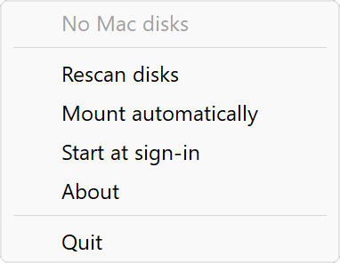

# apfsmount


A Windows app that mounts a Mac disk (APFS or HFS+) as a read-only drive.
It runs in the notification area, and as a command-line tool.
Explorer, copy and robocopy work as on any drive.

Tested on real hardware: a Mac OS X system disk (HFS+, 10,765 entries listed, 2 GB copied)
and a USB stick formatted APFS by iPadOS (all 1,363 files checked).
A Mac system disk with APFS is not tested yet.

**Download:** [latest release](https://github.com/poeggi/apfsmount/releases/latest)
(setup, `SHA256SUMS`, licenses).
The command-line tool alone:
[apfsmount.exe](https://github.com/poeggi/apfsmount/releases/latest/download/apfsmount.exe).

## Requirements

- Windows 11 or Windows Server 2025, x64, an administrator account.
- [WinFsp](https://github.com/winfsp/winfsp/releases) 2.2.26323 (WinFsp 2026) or later.
  Older versions have known vulnerabilities (CVE-2026-3006 and others).
  The setup downloads and installs it if needed.
  Before it updates WinFsp, it asks if other WinFsp drives are mounted: the update closes them.

## Install

Run `apfsmount-<version>-setup.exe`. It installs to `C:\Program Files\apfsmount`.

The setup is not signed:

- SmartScreen warns. Click "More info", then "Run anyway".
- Smart App Control (Windows 11) blocks it.
- Check the download: `Get-FileHash apfsmount-<version>-setup.exe` must match `SHA256SUMS`, ignoring case.

Silent install: `apfsmount-<version>-setup.exe /VERYSILENT /SUPPRESSMSGBOXES /NORESTART`.
An older version over a newer one then needs `/ALLOWDOWNGRADE`.

Uninstall: Settings > Apps > apfsmount. WinFsp stays installed.

apfsmount and [ufsmount](https://github.com/poeggi/ufsmount) install and run side by side.
Each has its own tray, start task and drive letters.

## Start and stop



- Start: Start menu > apfsmount.
  The icon  appears in the notification area.
- Windows 11 may hide it behind the ^ arrow.
  To keep it visible: Settings > Personalization > Taskbar > Other system tray icons > apfsmount tray.
- The user who ran the setup gets no UAC prompt. Other accounts get one.
- Every Mac file system is mounted: M: first, then L:, K: down to D:, then N: up to U:.
- Plugging in a disk mounts it. Unplugging unmounts it.
- "Eject" (Safely Remove Hardware) works on a mounted disk: it is unmounted first.
- Right-click the icon: Open or Unmount a drive, Rescan disks, Quit (unmounts all; asks first while a drive is mounted).
- "Drive letter" in a drive's menu moves it to another letter. The letter is remembered for that file system.
- "Mount automatically" is on by default. Turned off, found file systems wait under "Not mounted".
  Unmounted ones wait there too. "Mount on" or "Mount as" mounts one.
- "Start at sign-in" in the icon's menu starts it at every sign-in. The setup has the same choice.
- About shows the versions. Each time it opens, it asks GitHub whether a newer release exists.
  Nothing is downloaded.
- Log: `C:\ProgramData\apfsmount\tray\tray.log`.

## Disks

- Any disk Windows sees: SATA, eSATA, NVMe, USB disks and sticks, card readers, iSCSI.
- Sectors of 512 or 4096 bytes.
- GPT partitions, Apple Partition Maps, and a file system without any partition table.
- APFS: each volume of a container is a file system of its own.
  System volumes (Preboot, Recovery, VM, Update) are listed, and mounted only on request.
- HFS+ and HFSX, also inside an HFS wrapper.

## Command line

Use an elevated prompt. The setup adds the folder to PATH.

```
apfsmount probe PhysicalDrive1
apfsmount mount PhysicalDrive1 M:
apfsmount ls PhysicalDrive1 /Users
apfsmount cp PhysicalDrive1 /Users/me D:\backup
```

- `Get-Disk` shows the disk number. `probe` lists partitions and Mac file systems.
- `mount` keeps M: until Ctrl+C or until the window closes.
- `--part p2v1` picks a file system when a disk has several.
- An image file works in place of the disk: `apfsmount mount disk.img M:`.

The WinFsp launcher (`net use`) mounts without an open window:

```
apfsmount register
net use M: \\apfs\PhysicalDrive1 /persistent:no
net use M: /delete
```

- Run `register` once. All three need an elevated prompt.
- The launcher takes disks (`PhysicalDriveN`), not optical drives.
- `register` needs `apfsmount.exe` under `C:\Program Files`, as the setup installs it.

## Limits

- Read-only.
- Encrypted volumes (FileVault) are found and refused.
- Not read: snapshots, Fusion drives, plain HFS (before HFS+).
- A bad sector fails only the files that use it.
- A damaged or crafted disk that makes a reader loop fails that request with an error.
  A deliberately crafted APFS disk can still make the tray run out of memory.
  The fix belongs in the APFS reader library.
- Symlinks are Windows symlinks. Use `robocopy /XJ` or `/SL` to avoid loops.

## Build

Needs Rust stable, Visual Studio Build Tools (C++) and LLVM (libclang).
The setup needs [Inno Setup](https://jrsoftware.org/isinfo.php) 7.1.1.

```
cargo build --release
cargo test
ISCC /DAppVersion=<version> products\apfsmount\installer.iss
```

The setup goes to `temp\installer`.

The shared part, `win-mountkit`, comes from [ufsmount](https://github.com/poeggi/ufsmount),
pinned to a release tag: disks, WinFsp, the command line and the tray.
`products/apfsmount` holds the APFS and HFS+ code, the names, texts, logo and setup settings.

## Credits

- [APFS Explorer](https://github.com/enesilhaydin/apfs-explorer) by enesilhaydin and contributors:
  its reader `apfs-core` reads APFS (GPL-3.0-only).
- [hfsplus and cmpfs](https://github.com/Dil4rd/dpp) by Dil4rd read HFS+ and its compressed files (MIT).
- WinFsp - Windows File System Proxy, Copyright (C) Bill Zissimopoulos.
  https://github.com/winfsp/winfsp
- [winfsp-rs](https://github.com/SnowflakePowered/winfsp-rs) by SnowflakePowered and contributors (GPL-3.0).

## License

AGPL-3.0-or-later, see `LICENSE`.
